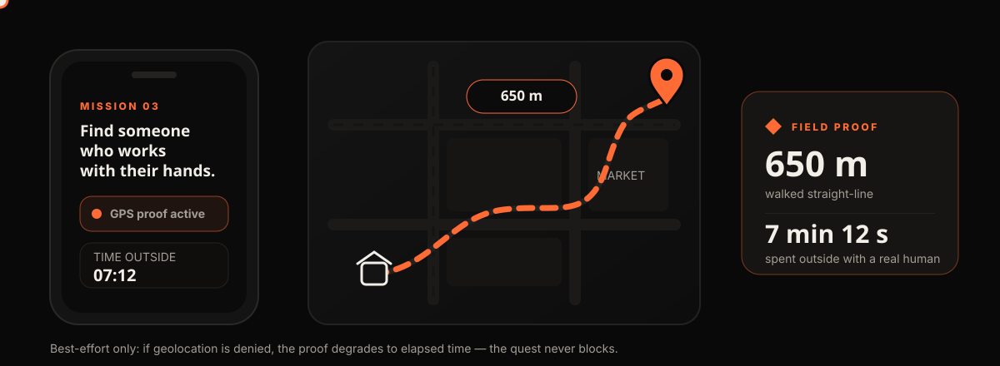
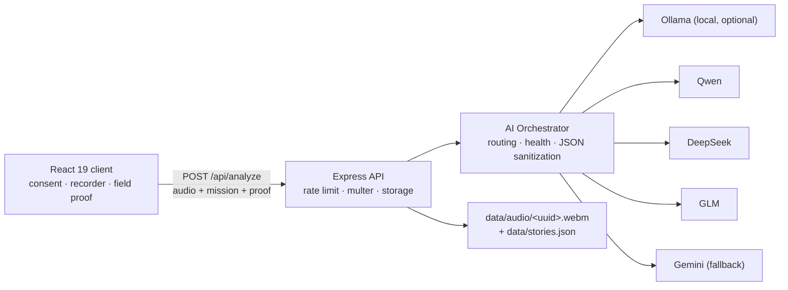
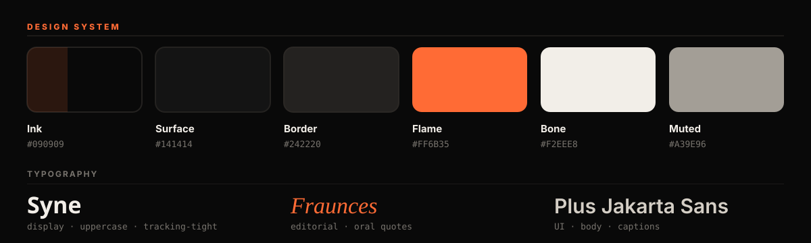

<p align="center">
  
</p>

<h1 align="center">PALABRE</h1>

<p align="center">
  <em>Your phone knows the internet. Your neighborhood knows the stories.</em>
</p>

<p align="center">
  
  
  
  
  
</p>

<p align="center">
  
  
  
</p>

<br />

<p align="center">
  
</p>

---

PALABRE is a real-world cultural treasure hunt powered by AI, designed intentionally to make people spend **less time on screens** and **more time talking to real human beings**.

Starting from the neighborhoods of Yaoundé, Cameroon, and extending outward to streets and communities worldwide, PALABRE transforms smartphones into catalysts for oral history preservation.

> [!IMPORTANT]
> **No chatbots. No endless scrolling. No simulated conversations.**
> The technology is an invisible dispatch and analysis engine — the human interaction, the voice recording and the cultural discovery all happen **outside, in the real world**.

---

## Table of contents

1. [Why PALABRE exists](#1-why-palabre-exists)
2. [The core loop](#2-the-core-loop)
3. [Field proof — evidence you went outside](#3-field-proof--evidence-you-went-outside)
4. [Persisted voices — the archive keeps the voice](#4-persisted-voices--the-archive-keeps-the-voice)
5. [Architecture & AI orchestrator](#5-architecture--ai-orchestrator)
6. [Hackathon transparency](#6-hackathon-transparency)
7. [Quick start & environment variables](#7-quick-start--environment-variables)
8. [API endpoints](#8-api-endpoints)
9. [Testing](#9-testing)
10. [Design system](#10-design-system)
11. [Speech-to-text & next step](#11-speech-to-text--next-step)
12. [License](#12-license)

---

## 1. Why PALABRE exists

Modern digital technology consumes attention through endless algorithmic feeds. Meanwhile, living community memory — the proverbs repeated by elders, the craft lessons learned with hands, the migration stories preserved across generations — vanishes silently without leaving a trace on the web.

PALABRE reverses the formula:

| Feed apps | PALABRE |
| :--- | :--- |
| Keep you scrolling at home | Send you out with a mission |
| Talks *to* you | Asks you to talk to a **real human** |
| Generates content | Preserves **voices that already exist** |
| Requires constant connectivity | Works degraded offline, queues gracefully |

---

## 2. The core loop

<p align="center">
  
</p>

Every completed mission **chains the next one directly from the story that was just heard**, so the quest never resets to a generic prompt.

<details>
  <summary><b>Textual / ASCII view of the loop</b></summary>

```text
MISSION
  ↓ (Put phone down, walk outside)
REAL HUMAN
  ↓ (Ask meaningful question, get verbal consent)
VOICE
  ↓ (Record spoken answer)
MULTI-PROVIDER AI ORCHESTRATOR
  ↓ (Ollama / Qwen / DeepSeek / GLM / Gemini extracts wisdom, theme, significance)
CULTURAL KNOWLEDGE
  ↓ (Preserved in neighborhood memory)
NEXT MISSION (Directly chained from the story)
  ↓ (Walk outside again)
...
```

</details>

---

## 3. Field proof — evidence you went outside

The hackathon theme is *open-source AI that gets people out of their homes* — so PALABRE measures the physical part, not just the digital one.

<p align="center">
  
</p>

**How it works**

| Moment | What happens |
| :--- | :--- |
| Consent confirmed | Clock starts + best-effort GPS fix (`useOutdoorProof.beginMission`) |
| Story submitted | Elapsed time + fresh GPS fix → straight-line distance (`haversine`) |
| Server | Values validated, stored on the story, returned as `proof` |
| Result screen | **FIELD PROOF** card: `650 m walked · 7 min 12 s outside` |
| Archive | Small footprint badge next to every collected story |

> [!TIP]
> **Privacy by design:** raw coordinates are **never stored and never leave the device** — only the derived distance (metres) and duration (seconds) are sent to the server.

> [!NOTE]
> **Best-effort only:** if the user denies geolocation (or no fix is available), the proof degrades to elapsed time. The quest is never blocked, never retried, never faked.

**Payload fields** (all optional, multipart `POST /api/analyze`):

| Field | Type | Meaning |
| :--- | :--- | :--- |
| `outdoorDurationSec` | number | Seconds between mission start and submission |
| `distanceMeters` | number | Straight-line distance walked (metres) |

**Response addition:** `"proof": { "durationSec": 420, "distanceM": 650 }` (omitted when unavailable).

---

## 4. Persisted voices — the archive keeps the voice

An oral archive without the original voice is just text. PALABRE now preserves the recording itself:

| Step | Behaviour |
| :--- | :--- |
| Upload | Multer buffers the audio in memory (25 MB max, audio/* only) |
| After analysis | Raw file written to `data/audio/<uuid>.<ext>` — **never on analysis failure** |
| Story | Gains `audioUrl: "/audio/<uuid>.webm"` |
| Serving | `GET /audio/<file>` static route (7-day immutable cache, UUID names, no directory listing) |
| UI | The archive modal plays the **original voice** of every story |

> [!NOTE]
> Graceful degradation: if the disk is read-only or full, the write is logged and the story is still saved — without an `audioUrl`.

`data/audio/` is git-ignored; stories metadata stays in `data/stories.json`.

---

## 5. Architecture & AI orchestrator

PALABRE decouples application logic from any single AI vendor through a unified **AI Orchestrator**:

<p align="center">
  
</p>

<details>
  <summary><b>Mermaid view of the request flow</b></summary>



</details>

### Supported providers

| # | Provider | Nature | Activation |
| :---: | :--- | :--- | :--- |
| 0 | **Ollama** (`ollama`) | Open source, **runs locally** | `OLLAMA_BASE_URL` set (e.g. `http://localhost:11434/v1`) |
| 1 | **Qwen** (`qwen`) | Open-weight (Alibaba) | `QWEN_API_KEY` |
| 2 | **DeepSeek** (`deepseek`) | Open-weight | `DEEPSEEK_API_KEY` |
| 3 | **GLM** (`glm`) | Open-weight (Zhipu / THUDM) | `GLM_API_KEY` |
| 4 | **Gemini** (`gemini`) | Proprietary fallback | `GEMINI_API_KEY` |

**Automatic fallback** (`AI_PROVIDER=auto`): providers are tried in `AI_PROVIDER_ORDER` (`ollama,qwen,deepseek,glm,gemini`). Unconfigured providers are **silently skipped**; a timeout, `5xx` or malformed JSON cascades to the next configured one without interrupting the explorer.

```bash
# Fully local, open-source run — nothing leaves the machine:
ollama pull qwen2.5:7b
echo 'OLLAMA_BASE_URL="http://localhost:11434/v1"' >> .env
npm run dev
```

> [!NOTE]
> Without `OLLAMA_BASE_URL`, behaviour is **exactly** what it was before: the Ollama provider is not registered as configured and the cloud cascade takes over.

---

## 6. Hackathon transparency

To uphold open-source hackathon integrity:

| Component | Nature | License / Classification |
| :--- | :--- | :--- |
| **PALABRE Application Code** | Open Source | Apache-2.0 |
| **Ollama Runtime (optional)** | Open Source | MIT License — runs fully locally, no data leaves the machine |
| **Qwen Models** | Open-Weight | Qwen Research License / Apache-2.0 depending on weight size |
| **DeepSeek Models** | Open-Weight | DeepSeek License |
| **GLM Models** | Open-Weight | GLM Community / Open Model License |
| **Gemini Models** | Proprietary | Closed-source Google Cloud hosted API |
| **Hosting & API Endpoints** | Cloud Infrastructure | DashScope, DeepSeek, Zhipu, Google Cloud |

*PALABRE provides an architecture that can point to hosted cloud APIs **or** self-hosted local instances (Ollama, vLLM, llama.cpp).*

---

## 7. Quick start & environment variables

```bash
# 1. Install
npm install            # or bun install

# 2. Configure
cp .env.example .env   # then fill in at least one provider

# 3. Run
npm run dev            # http://localhost:3000
```

Configure providers in `.env` (refer to `.env.example`):

```bash
# Provider Mode: 'auto', 'ollama', 'qwen', 'deepseek', 'glm', or 'gemini'
AI_PROVIDER="auto"

# Fallback Cascade Order ('ollama' is skipped when OLLAMA_BASE_URL is empty)
AI_PROVIDER_ORDER="ollama,qwen,deepseek,glm,gemini"

# --- Provider 0: Ollama (Local Open-Source, Optional) ---
OLLAMA_BASE_URL=""
OLLAMA_MODEL="qwen2.5:7b"

# --- Provider 1: Qwen ---
QWEN_API_KEY="your_dashscope_api_key"
QWEN_BASE_URL="https://dashscope-intl.aliyuncs.com/compatible-mode/v1"
QWEN_MODEL="qwen2.5-72b-instruct"

# --- Provider 2: DeepSeek ---
DEEPSEEK_API_KEY="your_deepseek_api_key"
DEEPSEEK_BASE_URL="https://api.deepseek.com/v1"
DEEPSEEK_MODEL="deepseek-chat"

# --- Provider 3: GLM / Zhipu AI ---
GLM_API_KEY="your_zhipu_api_key"
GLM_BASE_URL="https://open.bigmodel.cn/api/paas/v4"
GLM_MODEL="glm-4-flash"

# --- Provider 4: Gemini (Optional Fallback) ---
GEMINI_API_KEY="your_gemini_api_key"
GEMINI_MODEL="gemini-3.1-flash-lite"

# --- Speech-to-Text: open-source Whisper worker (optional) ---
WHISPER_ENDPOINT=""

# Server Port
PORT=3000

# Demo Mode (offline mock for automated environments)
DEMO_MODE=false
```

---

## 8. API endpoints

| Method | Route | Purpose |
| :---: | :--- | :--- |
| `GET` | `/api/health` | Runtime status + multi-provider readiness (`configuredProviders`, `activeProvider`, `fallbackOrder`) |
| `GET` | `/api/ai/capabilities` | Declared capabilities of every LLM/STT provider |
| `GET` | `/api/health/monitor` | Health monitor statistics |
| `POST` | `/api/health/check` | Forces an immediate health verification |
| `GET` | `/api/mission/start` | Generates or resumes a quest session with a starter quest |
| `POST` | `/api/analyze` | Multipart audio → multi-provider analysis → structured cultural insights |
| `GET` | `/api/stats` | Count of persistent stories |
| `GET` | `/api/stories` | Public collective oral history archive (incl. `audioUrl`, field proof) |
| `GET` | `/audio/<file>` | Original voice recording (`data/audio/`) |

**`POST /api/analyze` inputs:** `audio` *or* `transcript`, `missionText`, `missionNumber`, `sessionId`, `audioDurationSec`, `userId`, `outdoorDurationSec`, `distanceMeters`.

**Response:** `transcript`, `theme`, `extracted`, `summary`, `culturalSignificance`, `nextMission`, `providerUsed`, `sessionCount`, `totalStories`, `proof`.

---

## 9. Testing

```bash
npm run lint                       # tsc --noEmit

npx tsx tests/runAiTests.ts              # 13 tests · provider config, JSON sanitization, orchestrator
npx tsx tests/runAll13Tests.ts           # 13 tests · fallback cascade, contract, log-safety
npx tsx tests/runMockHttpTests.ts        # 2 tests  · mocked network success & Qwen → DeepSeek
npx tsx tests/runHealthAndRoutingTests.ts# 15 tests · capability routing, STT, debug panel
npx tsx tests/runHealthMonitorTests.ts   # 5 tests  · health monitor lifecycle & recovery
```

**Total: 48 tests passing.**

> [!WARNING]
> `runHealthMonitorTests` assumes no provider key in the environment. Unset it first if your shell exports one:
> `env -u DEEPSEEK_API_KEY npx tsx tests/runHealthMonitorTests.ts`

---

## 10. Design system

<p align="center">
  
</p>

| Token | Value | Role |
| :--- | :--- | :--- |
| `--bg-primary` | `#090909` | Ink — full-screen background |
| `--surface` | `#141414` | Cards & panels |
| `--border` | `#242220` | Hairline borders |
| `--accent` | `#FF6B35` | Flame — CTA, proof, recording state |
| `--text-primary` | `#F2EEE8` | Bone — primary text |
| `--muted` | `#77736D` | Secondary text |

**Typography** (loaded in `index.html`):

- **Syne** — `.font-display`, uppercase display headings
- **Fraunces** — `.font-editorial`, italic oral quotes
- **Plus Jakarta Sans** — body UI text
- **`ui-monospace` stack** — mission counters, timestamps, field labels

**Motion** (kept deliberately scarce — the app pushes you *away* from the screen):

- `animate-record-pulse` — orange halo while recording (`src/index.css`)
- `transition-transform active:scale-[0.98]` — tactile CTA press
- `animate-pulse` — live community status dot
- README assets are **animated SVGs** (CSS keyframes + SMIL), so no binary GIF/MP4 is shipped

---

## 11. Speech-to-text & next step

The LLM prompt layer is cleanly isolated from the audio layer. Text-only models (DeepSeek, GLM, Qwen chat) receive verified transcripts, while multimodal providers (Gemini, Qwen Audio) or pre-transcription handle voice ingestion.

### Next step for complete local open-source autonomy

Integrate a local open-source STT worker (`faster-whisper` / `whisper.cpp`) on `localhost:8001`:

```text
AUDIO → local faster-whisper (STT) → TRANSCRIPT → Ollama / Qwen / DeepSeek (LLM) → CULTURAL RESULT
```

This guarantees 100% offline edge execution for rural or off-grid field quests.

---

## 12. License

Apache-2.0
